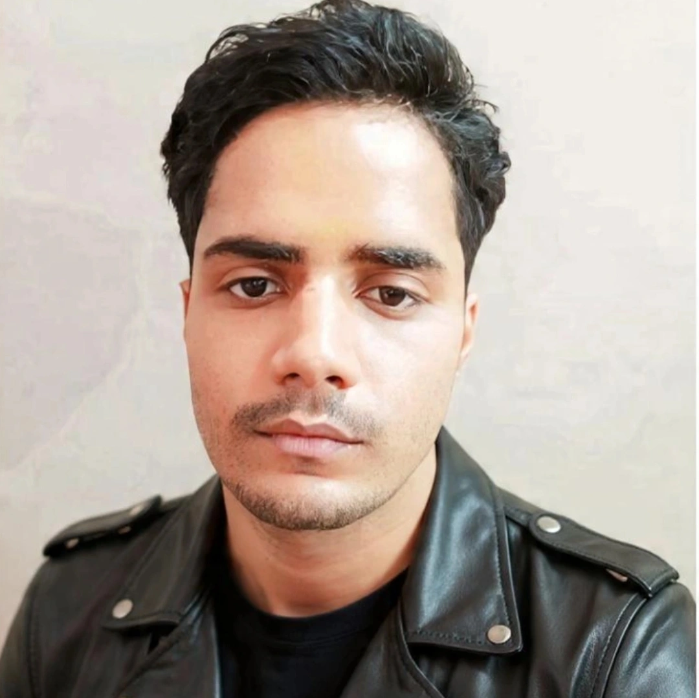

<h1 align="center">Hi 👋, I'm Aryan Kumar Dubey</h1>

<h3 align="center">
INDIA 🇮🇳 |M.Tech CSE 28 |  B.Tech CSE’25(Distinction)|Polytechnic IT’22(Honour)|  5 Publications & 24 Citations @ResearchGate | 1000+DSA solved on lc(Knight Badge)&GFG(Top 2K) 
</h3>
                <a href="https://aryan-we.github.io/Projects-Showcase/" font="red"><li>Project Showcase</li></li></a>
                <a href="https://codolio.com/profile/aryankumardubey"><li>Codolio Profile</li></a>
                <a href="https://www.researchgate.net/profile/Aryan-Dubey-7"><li>Research Gate</li></a>
                
        
<!--
**Aryan-we/Aryan-we** is a ✨ _special_ ✨ repository because its `README.md` (this file) appears on your GitHub profile.

Here are some ideas to get you started:

- 🔭 I’m currently working on ...
- 🌱 I’m currently learning ...
- 👯 I’m looking to collaborate on ...
- 🤔 I’m looking for help with ...
- 💬 Ask me about ...
- 📫 How to reach me: ...
- 😄 Pronouns: ...
- ⚡ Fun fact: ...
-->
